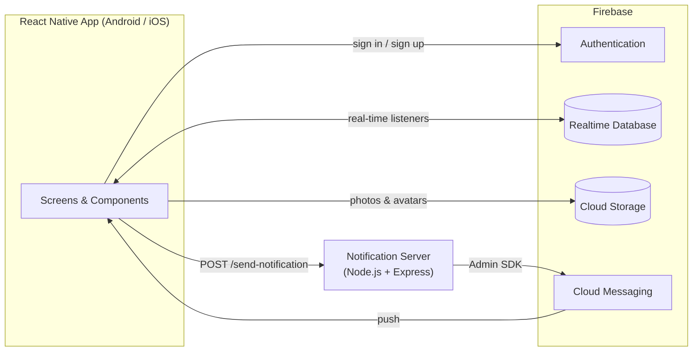

<div align="center">


# Karga

**A real-time messaging app for Android & iOS built with React Native and Firebase.**

One-to-one chats, group chats with role management, public chat rooms, live presence, read receipts, typing indicators and push notifications.


</div>

---

## Table of Contents

- [Features](#features)
- [Tech Stack](#tech-stack)
- [Architecture](#architecture)
- [Data Model](#data-model)
- [Project Structure](#project-structure)
- [Getting Started](#getting-started)
- [Known Limitations & Roadmap](#known-limitations--roadmap)

## Features

### Messaging
- **One-to-one chat** with real-time sync through Firebase Realtime Database listeners
- **Typing indicator** that is debounced and turns off after 2 seconds of inactivity
- **Contextual status line** in the chat header: *Typing… → In Conversation → Online → Last online 5 minutes ago*
- **Read receipts**: a message is marked as read instantly if the recipient is inside the chat
- **Unread badges** and last-message previews, with conversations sorted by latest activity
- **Day separators** in chat history (*Today*, *Yesterday*, *N days ago*, full date)
- **Photo sharing** from camera or gallery, uploaded to Firebase Storage with progress feedback and a full-screen viewer
- **Nudge / vibration messages**: vibrate a friend's phone while they are in the chat
- **Saved messages**: double-tap any message to star it and find it later on a dedicated screen

### Group Chats
- Create groups and invite friends (invitations arrive as in-app notifications)
- Group-aware presence: *"Alice is typing…"*, *"Multiple users are typing"*, *"3 users online"*
- **Seen by / Not seen yet** breakdown for each of your messages
- Targeted nudges: pick specific members, or all of them, who are currently in the chat
- Editable group photo, name and description
- **Role-based permissions (Owner / Admin / Member)**
  - Promote or demote admins, step down from admin, transfer ownership
  - Add or remove members
  - Automatic ownership hand-off when the owner leaves (another admin is preferred, otherwise a random member)
- Member list ordered by role, with online members first in each role
- Shared media gallery with "Load more" pagination

### Public Chat Rooms
- Anyone can create a room and others can join it
- Live connected-user counter kept consistent with Firebase transactions and `onDisconnect()` hooks

### Presence
- Online/offline status and *last seen* timestamps handled server-side via `onDisconnect()`, so they stay correct even if the app crashes or loses its connection
- Per-conversation "in chat" state, which suppresses push notifications while the user is reading the conversation

### Social Graph
- Search users by username
- Send, cancel, accept and reject friend requests, and remove friends
- **Notification center** with an unread indicator to accept or reject friend and group invitations

### Push Notifications
- A small **Node.js / Express** service that uses the **Firebase Admin SDK** to deliver FCM messages
- Foreground and background handling, a custom Android notification channel and a custom notification sound
- FCM tokens are refreshed on every sign-in

### Account & Profile
- Email/password sign-up, sign-in and password reset, validated with **Formik + Yup**
- Profile photo from camera or gallery with cropping; the previous image is removed from Storage
- Live **username availability check** (debounced)
- Secure password change with re-authentication (`reauthenticateWithCredential`)
- Profile stats (conversations, friends, groups) and public profile pages with shared media
- Notification preferences screen

## Tech Stack

| Layer | Technologies |
| --- | --- |
| Mobile | React Native 0.74, React 18, JavaScript |
| Navigation | React Navigation (Stack) |
| Backend-as-a-Service | Firebase Authentication, Realtime Database, Cloud Storage, Cloud Messaging |
| Notification server | Node.js, Express, Firebase Admin SDK |
| Forms & validation | Formik, Yup |
| UI | React Native Paper, react-native-modal, Linear Gradient, Vector Icons, Animated API |
| Media | react-native-image-crop-picker |
| Notifications | @react-native-firebase/messaging, react-native-push-notification |
| Utilities | moment.js |

## Architecture



The app talks to Firebase directly for authentication, data and media. Push notifications go through a lightweight Express endpoint, so the Admin credentials never ship inside the mobile binary.

## Data Model

Simplified shape of the Realtime Database:

```text
users/{uid}
  userName, bio, picture, online, lastOnlineTime, fcmToken
  friends[], friendRequests{}, sendRequests{}
  conversations{ conversationId: true }
  groups{ groupId: true }
  notifications{ ... }           # friend & group invitations
  savedMessages{ ... }
  muteAllNotifications, muteChatNotifications, ...

conversations/{conversationId}
  members[2], lastMessageTime
  messages/{messageId}  { text, userId, userName, timestamp, messageType, read }
  userStatus/{uid}      { inChat, write, lastLeft }

groups/{groupId}
  name, description, picture, author, directors[], members[], lastMessageTime
  messages/{messageId}  { ..., read[uid], selectedUsers[] }
  userStatus/{uid}      { inChat, write, lastLeft }

rooms/{roomId}            { name, userId, userName, connectedUserCount }
messages/{roomId}/{id}    { text, userId, userName, timestamp }
```

`messageType` is one of `text`, `image` or `vibration`.

## Project Structure

```text
.
├── App.jsx                     # FCM + local notification bootstrap
├── server/
│   └── index.js                # Express push-notification service
└── src/
    ├── Route.js                # Stack navigator
    ├── config.example.js       # Template for environment-specific config
    ├── Components/
    │   └── Rooms/              # Message bubble, room list item
    └── Screens/
        ├── Splash/             # Session check & routing
        ├── Login/  Register/  ForgotPassword/
        ├── Home/               # Tabs: Messages, Groups, Rooms, Profile
        ├── Chat/               # Shared chat screen (DM / group / room)
        ├── GroupDetails/       # Group settings, roles, media
        ├── UserDetails/        # Public profile & friendship actions
        ├── Friends/            # Friends, requests, user search
        ├── EditProfile/
        ├── SavedMessages/
        └── NotificationSettings/
```

## Getting Started

### Prerequisites
- Node.js 18+
- A working [React Native environment](https://reactnative.dev/docs/set-up-your-environment) (Android Studio and/or Xcode)
- A Firebase project with **Authentication (Email/Password)**, **Realtime Database**, **Storage** and **Cloud Messaging** enabled

### 1. Install dependencies

```bash
git clone https://github.com/atahanhalici/Karga---ChatApp-With-React-Native.git
cd Karga---ChatApp-With-React-Native
npm install
cd ios && pod install && cd ..   # iOS only
```

### 2. Add your Firebase configuration

These files are git-ignored and must be provided locally:

| File | Where to get it |
| --- | --- |
| `android/app/google-services.json` | Firebase Console → Project settings → Android app |
| `ios/GoogleService-Info.plist` | Firebase Console → Project settings → iOS app |
| `server/serviceAccountKey.json` | Firebase Console → Project settings → Service accounts → Generate new private key |

### 3. Configure endpoints

```bash
cp src/config.example.js src/config.js
```

Then set `DATABASE_URL` to your Realtime Database URL and `NOTIFICATION_SERVER_URL` to the address of the notification server. When running on a physical device, use your machine's LAN IP.

### 4. Start the notification server

```bash
node server/index.js
# or point to a key stored elsewhere:
FIREBASE_SERVICE_ACCOUNT_PATH=/path/to/key.json PORT=3000 node server/index.js
```

### 5. Run the app

```bash
npm start          # Metro bundler
npm run android    # or: npm run ios
```

## Known Limitations & Roadmap

- [ ] Enforce notification preferences on the server before sending pushes
- [ ] Deploy the notification server (e.g. Cloud Functions) instead of a local endpoint
- [ ] Add Firebase Security Rules to the repository
- [ ] Message pagination for long histories
- [ ] Social login (Google / Facebook / X); the buttons are already in the UI
- [ ] Migrate to TypeScript and add unit tests

---

<div align="center">
Developed by <a href="https://github.com/atahanhalici">Atahan Halıcı</a>
</div>
